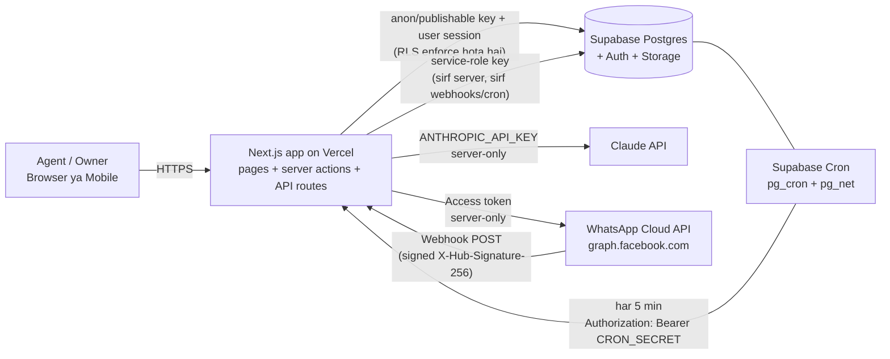

# 02 — Tech Stack, Architecture aur Monthly Cost (INR)

> **Prices ke baare mein important note:** Neeche ke saare prices October 2026 mein public sources se liye gaye hain aur **badal sakte hain**. Har service ka official pricing page sign-up se pehle khud check karo. USD → INR ke liye **₹96 = $1** maana hai (approx; live rate check karo). Indian card se foreign payment par bank **forex markup (~2–3.5%)** aur kai cases mein **18% GST** extra lag sakta hai.

---

## 1. Recommended stack (beginner + Chromebook friendly)

| Layer | Choice | Kyun? | Alternative jo consider kiya |
|---|---|---|---|
| **Frontend + Backend** | **Next.js (App Router) + React + TypeScript** | Ek hi project mein UI *aur* server code (API routes / Server Actions). Vercel par 1-click deploy. TypeScript galtiyan code chalne se pehle pakad leta hai — beginner ke liye actually helpful hai, kyunki AI-likha code bhi check ho jaata hai. | Plain React + alag Express server (2 projects manage karne padenge — beginner ke liye zyada). |
| **UI styling** | **Tailwind CSS + shadcn/ui** | Ready-made buttons, tables, forms, dialogs. Copy-paste components, koi heavy library lock-in nahi. | Material UI (bhaari), plain CSS (slow). |
| **Database** | **Supabase (PostgreSQL)** | Real SQL database, managed (backup, updates unka kaam). Row Level Security se agencies ka data alag. Dashboard mein table editor — beginner data dekh sakta hai. | Firebase (NoSQL — reports/joins mushkil), PlanetScale/Neon (auth alag se lena padega). |
| **Auth** | **Supabase Auth** | Email/password, magic link, password reset, sessions — sab built-in. Database ke RLS ke saath directly judta hai (`auth.uid()`). | Clerk / Auth0 (extra service + extra bill). |
| **File storage** | **Supabase Storage** | Property photos. Private buckets + RLS policies. | Cloudinary / S3. |
| **Hosting** | **Vercel** | Next.js banane wali company. GitHub push karo → auto deploy. Har branch ka preview URL. | Netlify (theek hai), Render/Railway (server manage karna padta hai). |
| **Scheduled jobs** | **Supabase Cron (`pg_cron` + `pg_net`)** | Database ke andar hi cron. Har 5 minute humare `/api/cron/*` route ko secret header ke saath call karega. Free plan par bhi chalta hai. Vercel Hobby ka cron sirf din mein ek baar chal sakta hai — isliye Supabase Cron better. | Vercel Cron (Pro plan par per-minute), Inngest / Upstash QStash (extra service). |
| **WhatsApp** | **Official WhatsApp Business Platform — Cloud API (Meta direct)** | Meta khud host karta hai, koi BSP (middleman) fee nahi. Webhooks + Graph API. | BSPs (Gupshup, Interakt, AiSensy, WATI etc.) — setup aasaan par monthly fee + per-message markup. Agar Meta verification mein dikkat aaye to fallback. |
| **AI** | **Claude API (Anthropic)** | Transparent per-token pricing, prepaid credits (bill control mein), API data by default model training ke liye use nahi hota (current terms check karo). Server-side call only. | OpenAI / Gemini — similar; ek hi provider rakhenge simplicity ke liye. |
| **Validation** | **Zod** | Form aur API input check (galat phone/budget database tak na pahunche). | — |
| **Testing** | **Vitest** (logic), **Playwright** (browser flows), SQL scripts (RLS isolation) | Playwright Chromebook ke Linux mein chalta hai. | Jest / Cypress. |
| **Code hosting** | **GitHub** | Version history + Vercel se connect. | — |

### Chromebook par development kaise hoga?

Do raaste — dono kaam karte hain:

1. **Recommended: Chromebook Linux (Crostini)**
   Settings → *About ChromeOS* → *Developers* → **Linux development environment → Turn on** (≈10 GB disk do). Isme terminal milta hai jahan Node.js, Git, VS Code (Linux .deb) install honge. 4 GB RAM par bhi chalega, 8 GB par smooth.
   *Agar school/office managed Chromebook hai to yeh option band ho sakta hai.*
2. **Fallback: GitHub Codespaces** (browser mein VS Code + terminal). Personal accounts ko har mahine kuch free hours milte hain; uske baad paid. Free limit GitHub ke billing page par check karo.

**Humara workflow (minimal manual coding):** Main (Claude) code likh ke GitHub branch par push karunga → Vercel har push ka **preview URL** banayega → aap browser mein test karoge → error aaye to exact error message mujhe paste karoge → main fix karunga. Local machine par chalana optional hoga, par Phase 2 mein ek baar setup karenge taaki aap seekh sako.

---

## 2. Architecture (kaun kis se baat karta hai)

**Simple shabdon mein:**
- **Browser** sirf Next.js se baat karta hai. Browser mein koi secret key nahi hoti.
- **Next.js server** (Vercel par) teen secret cheezein jaanta hai: Supabase service-role key, Claude API key, WhatsApp token. Yeh `.env` / Vercel Environment Variables mein rehti hain, code mein nahi.
- **Supabase** data store karta hai aur har query par check karta hai "yeh user is agency ka member hai ya nahi" (RLS).
- **Meta (WhatsApp)** naye messages aane par humare `/api/webhooks/whatsapp` ko call karta hai.
- **Supabase Cron** har 5 minute humare `/api/cron/tick` ko jagata hai jo reminders/jobs chalata hai.

### Golden security rule — API keys kabhi frontend mein nahi
- Next.js mein jo env variable `NEXT_PUBLIC_` se shuru hota hai, **woh browser mein dikh jaata hai**. Sirf Supabase URL aur anon/publishable key public hongi (yeh public hone ke liye hi bani hain — RLS inhe safe banata hai).
- `SUPABASE_SERVICE_ROLE_KEY` (Supabase ab ise "secret key" bhi kehta hai), `ANTHROPIC_API_KEY`, `WHATSAPP_*`, `CRON_SECRET`, `ENCRYPTION_KEY` — **kabhi `NEXT_PUBLIC_` nahi**, sirf server files mein (`import "server-only"` guard ke saath).

### Environment variables (plan)

| Variable | Public? | Kahan se milega | Kab chahiye |
|---|---|---|---|
| `NEXT_PUBLIC_SUPABASE_URL` | Haan | Supabase → Project Settings → API | Phase 2 Step 1 |
| `NEXT_PUBLIC_SUPABASE_ANON_KEY` (publishable) | Haan (RLS ke saath safe) | Same | Step 1 |
| `SUPABASE_SERVICE_ROLE_KEY` (secret) | **NAHI** | Same | Cron/webhooks (Step 3+) |
| `APP_URL` | Server | Vercel URL / domain | Step 1 |
| `CRON_SECRET` | **NAHI** | Khud random banayenge (`openssl rand -hex 32`) | Step 3 |
| `ANTHROPIC_API_KEY` | **NAHI** | console.anthropic.com → API Keys | Step 7 |
| `AI_MODEL` | Server | Aapka choice (neeche cost table dekho) | Step 7 |
| `WHATSAPP_APP_SECRET` | **NAHI** | Meta App Dashboard → App settings → Basic | Step 8 |
| `WHATSAPP_VERIFY_TOKEN` | **NAHI** | Khud random banayenge | Step 8 |
| `WHATSAPP_GRAPH_API_VERSION` | Server | Meta docs (current version) | Step 8 |
| `ENCRYPTION_KEY` | **NAHI** | Khud random (32 bytes) — agency ke WhatsApp tokens encrypt karne ke liye | Step 8 |

---

## 3. Har service ka cost — free tier ki asli limitations

### Supabase
| Plan | Price | Kya milta hai | Limitation jo aapko pata honi chahiye |
|---|---|---|---|
| Free | ₹0 | 2 active projects, 500 MB database, ~1 GB file storage, 50,000 monthly active users | **1 hafte inactivity par project pause** ho jaata hai (data safe, par manually restore karna padta hai). Backups ki guarantee nahi. **Real customers ke liye nahi.** |
| Pro | **$25/month ≈ ₹2,400** | 8 GB disk, 100 GB storage, 250 GB egress, 100k MAU, daily backups, no pausing, $10 compute credit (chhota instance cover) | Usage-based overage; **spend cap** default on rehta hai — on hi rakho. Bada compute ya Point-in-Time-Recovery alag paid add-ons. |

### Vercel
| Plan | Price | Limitation |
|---|---|---|
| Hobby | ₹0 | **Sirf personal, non-commercial use.** Paying customers aate hi Pro par jaana zaroori hai. Cron sirf din mein ek baar. |
| Pro | **$20/seat/month ≈ ₹1,920** (1 seat = sirf aap) | Included usage credit; uske upar bandwidth/function usage metered. **Spend Management** on karo. |

### WhatsApp Business Platform (Meta) — India rates
Meta ab **per-message** charge karta hai (category ke hisaab se). Third-party sources jo Meta ka rate card quote karte hain (effective 1 July 2026) — **official Meta pricing page par verify karna zaroori hai:**

| Message type | Example | Approx rate (India) |
|---|---|---|
| Marketing template | "Wakad mein naya 2BHK launch" | **~₹0.86** per delivered message |
| Utility template | "Kal 11 AM site visit confirm hai" | **~₹0.115** |
| Authentication template | OTP | ~₹0.115 |
| Incoming messages (lead ne bheja) | — | **Free** |
| Service replies (24-hour window mein free-form reply) | — | 1 Oct 2026 se: **har business number ko 1,000 free/month**, uske baad utility rate. (Reported change — verify.) |
| Free entry point (Click-to-WhatsApp ad / FB page CTA se aaya lead) | — | 72 ghante tak free (conditions apply) |

Upar se **18% GST**. Setup requirements: Meta Business Account, Meta Developer App, ek phone number jo abhi WhatsApp app par registered na ho (ya Meta ka "coexistence" option), business verification (messaging limits badhane ke liye), display name approval, payment method. Naye numbers ki daily business-initiated messaging limit chhoti se shuru hoti hai aur quality/verification ke saath badhti hai. **Development ke liye Meta ek free test number deta hai** jis se aap apne kuch verified numbers ko message kar sakte ho.

**Kaun pay karega?** Plan: har agency apna WhatsApp Business Account + payment method rakhegi, to messaging cost directly Meta unse lega. Humara SaaS bill alag.

### Claude API (AI) — per-token pricing (cached Oct 2026)
| Model | Input / 1M tokens | Output / 1M tokens | Kab use karein |
|---|---|---|---|
| `claude-opus-5-5` (Opus 5.5) | $4.00 | $20.00 | Best quality; default |
| `claude-sonnet-5-5` (Sonnet 5.5) | $2.00 | $10.00 | Achhi quality, aadha cost |
| `claude-haiku-5-5` (Haiku 5.5) | $0.10 | $0.50 | Bahut sasta; simple extraction/summary |

*Token ≈ ¾ English word; Hinglish/Hindi mein thode zyada tokens lagte hain.* Prepaid credits kharidne padte hain (card se, USD mein). Console mein **monthly spend limit** set kar sakte ho.

**Ek agency ka monthly AI usage (assumption):** 150 lead summaries (1,500 in / 400 out tokens), 600 reply suggestions (1,200 in / 250 out), 30 daily plans (6,000 in / 1,000 out), output par +50% buffer (AI ki "thinking" ke liye) → ~1.1M input + ~0.36M output tokens.

| Model | Per agency / month |
|---|---|
| Opus 5.5 | ≈ $11.7 ≈ **₹1,125** |
| Sonnet 5.5 | ≈ $5.9 ≈ **₹560** |
| Haiku 5.5 | ≈ $0.29 ≈ **₹28** |

> Model `AI_MODEL` env variable se choose hoga — badalne ke liye code change nahi chahiye. **Kaunsa model use karna hai, yeh aapka business decision hai** — Phase 2 Step 7 mein hum teeno ko same leads par test karke quality dekh sakte hain, phir aap decide karna. Har AI call ka token usage database mein log hoga taaki actual cost dikhe, estimate nahi.

### Baaki chhote kharche
| Item | Cost |
|---|---|
| Domain (.in / .com) | ~₹800–1,500/saal (≈ ₹70–125/month) |
| GitHub | Free (private repo bhi) |
| Transactional email (invites, password reset) | Supabase built-in email dev ke liye theek hai par **bahut limited rate** hai; production mein custom SMTP (Resend / Brevo / Amazon SES — free tiers available, limits check karo) |
| Error monitoring (Sentry) | Free tier se shuru |

---

## 4. Monthly operating cost — realistic estimate (INR)

### Stage A — Building + demo (Month 0–2)
| Item | ₹/month |
|---|---|
| Supabase Free (dev project) | 0 |
| Vercel Hobby | 0 |
| Meta WhatsApp test number | 0 |
| Claude API testing | ~100–500 (one-time prepaid credit, e.g. $5–10) |
| Domain (optional) | ~100 |
| **Total** | **≈ ₹0–600** |

### Stage B — Pilot with 3–5 paying agencies (~15 users)
| Item | ₹/month |
|---|---|
| Supabase Pro (production project) | ~2,400 |
| Vercel Pro (1 seat) | ~1,920 |
| Domain + email SMTP free tier | ~100 |
| Claude API (5 agencies) | ~150 (Haiku) / ~2,800 (Sonnet) / ~5,600 (Opus) |
| Forex markup + GST buffer (~20%) | ~900–2,000 |
| **Platform total (aapka kharcha)** | **≈ ₹5,500 – ₹12,000** |
| WhatsApp messaging (har agency khud Meta ko) | ~₹300–2,000 per agency, usage par |

Agar 5 agencies × ₹2,499 = ₹12,495/month revenue → pilot stage par break-even ke aas-paas.

### Stage C — 20 agencies (~80 users)
| Item | ₹/month |
|---|---|
| Supabase Pro + bada compute (zaroorat ho to) | ~2,400–4,000 |
| Vercel Pro | ~1,920–3,840 |
| Email (paid tier) + monitoring | ~0–2,000 |
| Claude API (20 agencies) | ~600 (Haiku) / ~11,200 (Sonnet) / ~22,500 (Opus) |
| Buffer (forex, GST) | ~20% |
| **Total** | **≈ ₹6,000 – ₹39,000** (model choice sabse bada factor) |

**Cost control ke tareeke (design mein shaamil):** per-agency AI usage limit, prompt caching, AI sirf button dabane par chale (auto nahi), daily plan raat ko ek baar banao, spend caps har service par.
