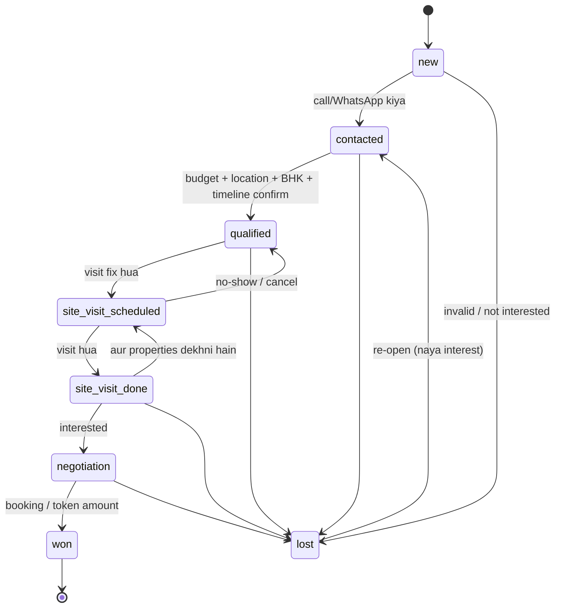

# 03 — Screens, Buttons, User Flows aur Lead-to-Deal Workflow

Legend: **[MVP]** = Version 1 · **[1.1]** = WhatsApp/AI assistant version · **[V2]** = baad mein

---

## 1. Sitemap (saare pages)

```
Public
├── /                         Landing page (product + "Join pilot")         [MVP]
├── /login                    Login                                          [MVP]
├── /signup                   Signup                                         [MVP]
├── /forgot-password          Reset link bhejo                               [MVP]
├── /reset-password           Naya password                                  [MVP]
└── /invite/[token]           Team invite accept                             [MVP]

Onboarding
└── /onboarding               "Create your agency"                           [MVP]

App (login required, agency-scoped)
├── /dashboard                Dashboard + aaj ki priority list               [MVP]
├── /leads                    Leads list (search/filter/sort/bulk)           [MVP]
├── /leads/new                Add lead                                       [MVP]
├── /leads/import             CSV import                                     [MVP]
├── /leads/[id]               Lead detail (tabs)                             [MVP]
├── /tasks                    Follow-ups: Today / Overdue / Upcoming / Done  [MVP]
├── /properties               Inventory list                                 [MVP]
├── /properties/new           Add property                                   [MVP]
├── /properties/[id]          Property detail + matching leads               [MVP]
├── /visits                   Site visits (list + week view)                 [MVP]
├── /deals                    Won/lost deals                                 [MVP]
├── /reports                  Lead source + agent performance                [MVP]
├── /inbox                    WhatsApp shared inbox                          [1.1]
├── /assistant                AI daily sales assistant                       [1.1]
├── /notifications            Saari notifications                            [MVP]
└── /settings
    ├── /settings/profile     Mera naam, phone, password                     [MVP]
    ├── /settings/agency      Agency naam, city, logo, timezone              [MVP]
    ├── /settings/team        Members, roles, invites                        [MVP]
    ├── /settings/whatsapp    Cloud API connection status                    [1.1]
    ├── /settings/templates   Approved templates list (synced)               [1.1]
    └── /settings/ai          AI on/off, monthly usage                       [MVP]
```

---

## 2. Screen-by-screen detail

### 2.1 Login / Signup / Forgot password [MVP]
- **Fields:** email, password (signup par naam bhi).
- **Buttons:** `Log in`, `Create account`, `Forgot password?`, `Send reset link`, `Set new password`.
- **Behaviour:** Signup → email confirmation link → `/onboarding`. Login par agar user kisi agency ka member nahi → `/onboarding`. Galat password par generic error ("Email ya password galat hai") — kaunsa galat hai nahi batayenge (security).

### 2.2 Onboarding — Create agency [MVP]
- **Fields:** Agency name, city, phone, (optional) RERA agent registration number.
- **Button:** `Create agency` → user is agency ka **Owner** ban jaata hai → `/dashboard`.
- Option: "Invite link mila hai?" → user invite link kholega.

### 2.3 Dashboard [MVP]
**Top cards (sab clickable → filtered leads/tasks list):**

| Card | Definition (exact) |
|---|---|
| Total active leads | status `won`/`lost` nahi, deleted nahi |
| 🔥 Hot / 🌤 Warm / ❄ Cold | active leads by temperature |
| Today's follow-ups | pending tasks jinka `due_at` aaj (IST) hai |
| Overdue | pending tasks jinka `due_at` < abhi |
| Site visits | is hafte scheduled · is mahine completed |
| Deals won | is mahine won count + total value |
| Conversion rate | last 90 din mein bane leads mein se kitne % won |
| No next action | active leads jinka koi pending follow-up nahi (⚠ warning) |

**Sections:**
- **"Aaj ki priority list"** (top 10, rule-based in MVP): overdue hot → aaj ke hot → overdue warm → 7 din se untouched warm. Har row par buttons: `Call` (tel: link), `WhatsApp` (wa.me), `Done + next`, `Open`.
- Upcoming site visits (next 48 hours).
- Leads by source (chhota bar chart).
- **Role filter:** Agent sirf apne numbers dekhta hai; Owner/Manager ke liye "All agents / specific agent" dropdown.

### 2.4 Leads list [MVP]
- **Top bar:** search box (name / phone / notes), `+ Add lead`, `Import CSV`, `Export CSV` (Owner/Manager only).
- **Filters:** status, temperature, source, assigned agent, BHK, property type, budget range, location, follow-up (overdue/today/this week/none), created date.
- **Sorting:** next follow-up (default), newest, budget, last contacted, name.
- **Table columns:** Name, Phone, Budget, Location, BHK, Status, Temp, Source, Assigned, Next follow-up (red agar overdue).
- **Row actions:** `Call`, `WhatsApp`, `Edit`, `Open`.
- **Bulk actions (checkbox select):** `Assign to…`, `Change status`, `Change temperature`, `Delete` (Owner/Manager).
- **Pagination:** 25/50 per page. Filters URL mein save (link share kar sakte ho, back button kaam kare).

### 2.5 Add / Edit lead [MVP]
- **Fields:** Name*, Phone* (Indian format → +91 E.164 me normalize), alternate phone, email, purpose (buy/rent), budget min/max (₹, "lakh/crore" helper), preferred locations (multi-tag), BHK (1/2/3/4/5+/plot/commercial), property type (apartment, villa, plot, independent house, commercial, other), source (99acres, MagicBricks, Housing.com, Facebook, Instagram, Google, website, walk-in, referral, WhatsApp, other), status, temperature, assigned to, next follow-up date-time, notes, **WhatsApp consent** checkbox + source ("Lead ne khud message kiya", "Form par opt-in", "Verbally agreed on call").
- **Duplicate check:** phone already exists → "Yeh lead pehle se hai (Agent X ke paas)" + `Open existing`.
- **Buttons:** `Save`, `Save & add another`, `Cancel`.

### 2.6 Lead detail [MVP]
**Header:** Name, phone, status dropdown, temperature chips, assigned agent, buttons `Call`, `WhatsApp`, `Schedule follow-up`, `Schedule site visit`, `Mark won`, `Mark lost`, `Edit`, `⋯ Delete`.

**Tabs:**
1. **Overview** — saari requirements, AI summary card (`Generate summary` / `Refresh`), qualification score with reasons.
2. **Timeline** — har activity: created, calls logged, notes, status changes, follow-ups done, visits, WhatsApp messages, AI actions (kis ne, kab). `Add note`, `Log call` (outcome: connected / not reachable / call back / not interested).
3. **Follow-ups** — pending + done tasks. `Add follow-up`.
4. **Matches** — matching properties (score + "kyun match hua": budget ✓, location ✓, BHK ✓). Buttons: `Share on WhatsApp` (pre-filled message with details), `Mark interested`, `Not interested`.
5. **Site visits** — list + `Schedule visit`.
6. **WhatsApp** [1.1] — conversation thread, 24-hour window timer, template picker, AI reply suggestion.
7. **AI Reply** [MVP] — `Suggest reply` → editable draft → `Copy` / `Open in WhatsApp` (MVP) / `Approve & send` (1.1). `Reject` bhi (feedback log hota hai).

### 2.7 CSV Import [MVP]
Upload → column mapping screen ("Excel ka 'Mobile' column = Phone") → preview (first 20 rows, errors red mein: invalid phone, duplicate) → `Import N leads` → summary (imported / skipped duplicates / errors CSV download).

### 2.8 Tasks / Follow-ups [MVP]
- **Tabs:** Today · Overdue · Upcoming · Done.
- **Row:** lead name, type (call / WhatsApp / meeting / visit reminder), due time, note, assigned.
- **Buttons:** `Done` (outcome + **next follow-up date required** unless lead closed), `Snooze` (1 hr / tomorrow / custom), `Reassign`, `Open lead`.

### 2.9 Properties [MVP]
- **List:** card/grid with photo, title, project, location, price, BHK, type, possession, status (available / on hold / sold). Filters same as leads.
- **Add/Edit:** title, project name, builder, address/locality, city, price (₹), price negotiable?, BHK, type, carpet area (sq.ft), floor, facing, furnishing, possession (ready / under construction + expected date), RERA project number, amenities (tags), description, photos (multi-upload, drag to reorder, max ~10, auto-compress).
- **Detail:** photos gallery, details, **Matching leads** list (`WhatsApp`, `Schedule visit`), `Edit`, `Mark sold`.

### 2.10 Site visits [MVP]
- **List + week view.** Filters: agent, status, date.
- **Schedule form:** lead, property (optional — "multiple properties" bhi), date-time, agent, meeting point, notes.
- **Buttons:** `Reschedule`, `Cancel`, `Mark completed` (feedback: liked / maybe / not interested + notes + next step), `Mark no-show`.
- **Reminders:** agent ko in-app (24h + 2h pehle) [MVP]; lead ko WhatsApp utility template [1.1, consent ke saath].

### 2.11 Deals [MVP]
List of won/lost. `Mark won` dialog: property, deal value, commission %, closing date. `Mark lost` dialog: reason (budget mismatch, bought elsewhere, not responding, postponed, other).

### 2.12 Reports [MVP]
- **Lead sources:** source → leads, contacted %, site visits, won, conversion %, (optional) spend → cost per lead/deal.
- **Agent performance** (Owner/Manager): leads assigned, follow-ups done on time %, overdue count, visits, won.
- **Funnel:** New → Contacted → Qualified → Visit scheduled → Visit done → Negotiation → Won.
- Date range picker, `Export CSV`.

### 2.13 Team settings [MVP]
Members table (name, email, role, status, leads count). Buttons: `Invite member` (email + role), `Change role`, `Deactivate` (deactivate karne par uske leads reassign karne ka prompt), `Resend invite`, `Revoke invite`.

### 2.14 WhatsApp Inbox [1.1]
Left: conversations (unread first, filter: mine / unassigned / all). Right: thread + lead side panel. Composer: free text (sirf 24h window mein), `Templates`, `✨ Suggest reply`. Opted-out leads par composer disabled + banner.

### 2.15 AI Assistant [1.1]
Roz subah ~8:30 AM IST ka plan: "Aaj ke Top 10" — har lead ke saath *kyun* (e.g. "3 din se reply nahi, budget match ho gaya naye listing se") aur *suggested action* + draft message. Buttons: `Start` (lead kholo), `Done`, `Skip today`.

### 2.16 Notifications [MVP]
Bell icon (unread count). Types: follow-up due, overdue, lead assigned to you, site visit reminder, WhatsApp incoming [1.1], job failure (Owner/Admin ko).

---

## 3. Main user flows

### Flow A — Agency setup
Signup → email verify → Create agency (Owner) → Settings/Team → Invite agents (email) → Agent invite link kholta hai → password set → agency mein join (role = Agent).

### Flow B — Naya lead se pehla follow-up
`+ Add lead` (ya CSV import) → assign agent → next follow-up set → agent ko notification "Naya lead assign hua" → follow-up time par task "Today" mein dikhta hai → agent `Call` → `Log call` (outcome) → status/temperature update → `Done + next follow-up`.

### Flow C — Property match aur share
Lead detail → Matches tab → property chuno → `Share on WhatsApp` → (MVP) wa.me link pre-filled message ke saath khulta hai → agent apne phone se bhejta hai → activity log hoti hai "Property X shared".

### Flow D — Site visit se deal
`Schedule site visit` → reminders → visit ke baad `Mark completed` + feedback → status `site_visit_done` → negotiation → `Mark won` (deal value, commission) → dashboard + reports update.

### Flow E — Incoming WhatsApp [1.1]
Lead WhatsApp karta hai → Meta webhook → (phone se) existing lead mila? warna naya lead "source = WhatsApp, unassigned" → inbox mein message → AI requirements extract karta hai (suggestion) → agent approve karke lead fields save karta hai → `✨ Suggest reply` → agent edit/approve → send.

### Flow F — Opt-out [1.1]
Lead "STOP" / "unsubscribe" / "band karo" bhejta hai → lead `opted_out` mark → consent event log → saare future template/scheduled messages us lead ke liye block → agent ko banner. Re-opt-in sirf tab jab lead khud dobara opt-in kare (message "START").

---

## 4. Lead-to-Deal workflow (state machine)



**Rules jo app enforce karega:**
1. **Status** (pipeline position) aur **temperature** (hot/warm/cold — kitni jaldi) alag cheezein hain.
2. Har active lead (won/lost nahi) ke paas **ek pending next follow-up** hona chahiye — `Done` dabate waqt next date maangi jaayegi; jinke paas nahi hai woh dashboard par "No next action" mein dikhte hain.
3. `lost` ke liye reason zaroori. `won` ke liye deal record bananaa zaroori.
4. Har status change → timeline activity (kis ne, kab, purana → naya).
5. Site visit schedule karne par status auto `site_visit_scheduled`; complete karne par `site_visit_done` (agent override kar sakta hai).
6. 7 din koi activity nahi + active → "stale" flag (priority list mein upar).
