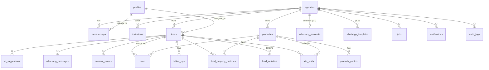

# 04 — Database Design, Auth, Permissions aur Agency Data Isolation

> Yeh **design** hai. Asli SQL migrations Phase 2 mein step-by-step banenge aur har step ke baad test honge. Column names English mein, explanations Hinglish mein.

---

## 1. Multi-tenancy ka basic idea (simple shabdon mein)

Ek hi database mein bahut saari agencies ka data hoga. Socho ek building jisme har agency ka alag flat hai:

- Har business table mein ek column hoga: **`agency_id`** — "yeh row kis flat ki hai".
- **`memberships`** table batata hai kaunsa user kis agency ka member hai aur uska role kya hai.
- **Row Level Security (RLS)** = building ka security guard. Har query par Postgres khud check karta hai: *"kya yeh user is row ki agency ka member hai?"* Agar nahi → row dikhegi hi nahi, chahe frontend code mein bug ho.

Isliye isolation **database level par** hai, sirf UI par nahi. Yahi sabse important security decision hai.

---

## 2. Entity-Relationship diagram



---

## 3. Tables (columns + kyun)

Common columns har business table mein: `id uuid primary key default gen_random_uuid()`, `agency_id uuid not null references agencies`, `created_at timestamptz default now()`, `updated_at timestamptz` (trigger se auto-update). Saare time **UTC `timestamptz`** mein store honge, screen par **Asia/Kolkata** mein dikhenge.

### 3.1 Core / tenancy [MVP]

**`agencies`** — ek customer company
| Column | Type | Note |
|---|---|---|
| name | text | |
| city | text | |
| phone | text | |
| timezone | text | default `Asia/Kolkata` |
| settings | jsonb | e.g. `{"agents_can_view_all_leads": false, "quiet_hours": ["21:00","09:00"]}` |
| plan | text | `pilot` / `paid` (billing V2) |

**`profiles`** — har login user ki extra info (`id` = `auth.users.id`)
| full_name text · phone text · avatar_url text |

**`memberships`** — user ↔ agency + role
| Column | Type | Note |
|---|---|---|
| agency_id | uuid | |
| user_id | uuid → auth.users | |
| role | enum `owner` / `manager` / `agent` | |
| status | enum `active` / `deactivated` | |
| unique | (agency_id, user_id) | |

**`invitations`**
| agency_id · email · role · token_hash (raw token sirf email link mein, DB mein hash) · invited_by · expires_at (7 din) · accepted_at · revoked_at |

### 3.2 Leads [MVP]

**`leads`**
| Column | Type | Note |
|---|---|---|
| name | text not null | |
| phone_e164 | text not null | `+919876543210` format; **unique (agency_id, phone_e164)** → duplicate prevention |
| alt_phone, email | text | |
| purpose | enum `buy` / `rent` | |
| budget_min, budget_max | bigint (₹ rupees) | lakh/crore UI mein convert |
| locations | text[] | preferred areas |
| bhk | text[] | `{2BHK,3BHK}` |
| property_type | enum | apartment, villa, plot, independent_house, commercial, other |
| source | enum/text | 99acres, magicbricks, housing, facebook, instagram, google, website, walk_in, referral, whatsapp, other |
| status | enum | new, contacted, qualified, site_visit_scheduled, site_visit_done, negotiation, won, lost |
| temperature | enum | hot, warm, cold |
| assigned_to | uuid → auth.users | null = unassigned |
| next_follow_up_at | timestamptz | denormalized (fast list sorting); trigger se sync |
| last_contacted_at | timestamptz | |
| last_inbound_at | timestamptz | WhatsApp 24-hr window calculate karne ke liye [1.1] |
| notes | text | |
| lost_reason | text | |
| whatsapp_opt_in | boolean default false | |
| opted_out_at | timestamptz | not null = **koi business-initiated message nahi** |
| ai_score | smallint (0–100) | |
| ai_summary | text | |
| ai_summary_updated_at | timestamptz | |
| created_by | uuid | |
| deleted_at | timestamptz | soft delete (galti se delete undo) |

Indexes: `(agency_id, status)`, `(agency_id, assigned_to)`, `(agency_id, next_follow_up_at)`, trigram index on name/phone for search.

**`lead_activities`** — timeline (append-only)
| lead_id · actor_id · type (`note`, `call`, `status_change`, `assignment`, `follow_up_done`, `visit`, `whatsapp_in`, `whatsapp_out`, `property_shared`, `ai`) · data jsonb (e.g. `{"from":"new","to":"contacted"}`) · created_at |

**`follow_ups`** — tasks / reminders
| Column | Type | Note |
|---|---|---|
| lead_id | uuid | |
| assigned_to | uuid | |
| type | enum `call` / `whatsapp` / `meeting` / `other` | |
| due_at | timestamptz | |
| status | enum `pending` / `done` / `skipped` / `cancelled` | |
| outcome | text | |
| completed_at, completed_by | | |
| reminder_sent_at | timestamptz | duplicate reminder rokne ke liye |

### 3.3 Inventory, visits, deals [MVP]

**`properties`**
| title · project_name · builder · locality · city · address · price bigint · price_negotiable bool · bhk text · property_type · carpet_area_sqft int · floor text · facing text · furnishing enum · possession_status enum (`ready`, `under_construction`) · possession_date date · rera_number text · amenities text[] · description · status enum (`available`, `on_hold`, `sold`) · created_by |

**`property_photos`** | property_id · storage_path (`{agency_id}/{property_id}/{uuid}.webp`) · sort_order |

**`lead_property_matches`** | lead_id · property_id · score smallint · reasons jsonb · status (`suggested`, `shared`, `interested`, `rejected`) · unique(lead_id, property_id) |

**`site_visits`** | lead_id · property_id (nullable) · assigned_to · scheduled_at · meeting_point · status (`scheduled`, `completed`, `no_show`, `cancelled`) · feedback enum (`liked`, `maybe`, `not_interested`) · notes · reminder_24h_sent_at · reminder_2h_sent_at |

**`deals`** | lead_id · property_id · deal_value bigint · commission_amount bigint · status (`won`, `lost`) · closed_at · lost_reason · closed_by |

### 3.4 Platform tables [MVP]

**`notifications`** | user_id · type · title · body · link · read_at |
**`audit_logs`** | actor_id · action (`lead.delete`, `member.role_change`, `lead.export`…) · entity · entity_id · diff jsonb |
**`jobs`** — background work queue (detail: doc 05)
| type · payload jsonb · run_at · status (`queued`, `running`, `succeeded`, `failed`, `dead`) · attempts · max_attempts (default 5) · last_error · **idempotency_key unique** · locked_at |
**`ai_suggestions`** | lead_id · kind (`summary`, `qualification`, `reply`, `daily_plan`) · model · input_tokens · output_tokens · output jsonb · status (`pending_review`, `approved`, `edited`, `rejected`, `sent`) · reviewed_by · reviewed_at · final_text |
**`usage_counters`** | agency_id · month · ai_calls · ai_input_tokens · ai_output_tokens · wa_messages_sent — per-agency limits + cost visibility |

### 3.5 WhatsApp tables [1.1]

**`whatsapp_accounts`** | agency_id unique · waba_id · phone_number_id **unique** (incoming webhook ko agency se map karta hai) · display_phone · access_token_encrypted (AES-256-GCM, key = `ENCRYPTION_KEY` env) · status · connected_at |
**`whatsapp_templates`** | name · language · category (`marketing` / `utility` / `authentication`) · status (`APPROVED`, `PENDING`, `REJECTED`, `PAUSED`) · components jsonb · synced_at |
**`whatsapp_messages`** | lead_id · direction (`in`/`out`) · **wa_message_id unique** · type (text, template, image…) · body · template_name · status (`queued`, `sent`, `delivered`, `read`, `failed`) · error_code · error_title · sent_by · ai_suggestion_id · idempotency_key unique |
**`consent_events`** — audit trail, kabhi delete/update nahi
| lead_id · phone_e164 · event (`opt_in`, `opt_out`) · channel (`whatsapp`) · source (`lead_initiated`, `web_form`, `verbal_on_call`, `keyword_stop`, `keyword_start`, `manual`) · evidence text · recorded_by · created_at |
**`webhook_events`** — raw incoming events (idempotency + debugging)
| provider · event_key **unique** · payload jsonb · signature_valid bool · received_at · processed_at · status · error |

**Tenant integrity trick:** child tables mein composite foreign key — e.g. `follow_ups (lead_id, agency_id) references leads (id, agency_id)`. Isse koi bug bhi Agency A ka follow-up Agency B ke lead se nahi jod sakta.

---

## 4. Authentication

- **Supabase Auth** — email + password, email confirmation on, password reset. (Google login V2 mein optional; phone OTP avoid — SMS ka per-message cost hai.)
- Session cookies `@supabase/ssr` library se — Next.js middleware har request par session refresh karega.
- Protected routes: `/dashboard`, `/leads`… bina login ke → `/login`. Bina agency ke → `/onboarding`.
- Password policy: min 8 chars; Supabase ka built-in rate-limiting login/signup par.
- **Current agency:** user ek se zyada agencies ka member ho sakta hai (V2 switcher); MVP mein pehli active membership use hogi, aur URL/cookie mein `agency_id` — par **RLS phir bhi verify karega**, cookie par bharosa nahi.

---

## 5. Roles aur permissions

| Action | Owner | Manager | Agent |
|---|:-:|:-:|:-:|
| Dashboard (poori agency) | ✅ | ✅ | Sirf apna |
| Leads dekhna | Sab | Sab | Sirf assigned (setting se "sab" on ho sakta hai) |
| Lead create | ✅ | ✅ | ✅ (auto-assign khud ko) |
| Lead edit | ✅ | ✅ | Sirf assigned |
| Lead assign / reassign | ✅ | ✅ | ❌ |
| Lead delete (soft) | ✅ | ✅ | ❌ |
| CSV import | ✅ | ✅ | ❌ |
| CSV export | ✅ | ✅ (audit log) | ❌ |
| Properties add/edit | ✅ | ✅ | ✅ (setting) |
| Site visits / follow-ups | Sab | Sab | Apne leads ke |
| Reports (agent performance) | ✅ | ✅ | ❌ |
| Team invite / roles | ✅ | Agents invite only | ❌ |
| Agency settings, WhatsApp connect, AI settings | ✅ | ❌ | ❌ |
| WhatsApp send [1.1] | ✅ | ✅ | Apne leads ko |

Yeh permissions **do jagah** enforce hongi: (1) UI (button chhupana — convenience), (2) **RLS policies + server checks (asli security)**.

---

## 6. RLS — kaise likhenge (design sketch)

```sql
-- Helper: kya current user is agency ka active member hai?
create or replace function public.is_member(p_agency uuid)
returns boolean language sql stable security definer set search_path = '' as $$
  select exists (
    select 1 from public.memberships m
    where m.agency_id = p_agency and m.user_id = auth.uid() and m.status = 'active'
  );
$$;

-- Helper: current user ka role
create or replace function public.my_role(p_agency uuid)
returns text language sql stable security definer set search_path = '' as $$
  select m.role::text from public.memberships m
  where m.agency_id = p_agency and m.user_id = auth.uid() and m.status = 'active';
$$;

alter table public.leads enable row level security;

create policy "leads: read" on public.leads for select to authenticated
using (
  deleted_at is null
  and public.is_member(agency_id)
  and (
    public.my_role(agency_id) in ('owner','manager')
    or assigned_to = (select auth.uid())
    or coalesce((select (a.settings->>'agents_can_view_all_leads')::boolean
                 from public.agencies a where a.id = agency_id), false)
  )
);
```

Similar policies insert/update/delete ke liye. Plus:
- **Trigger** jo `agency_id` ko update hone se rokta hai (row ek agency se doosri mein "shift" na ho).
- Har nayi table par `enable row level security` — ek **CI check / SQL test** jo fail kare agar kisi public table par RLS off hai.
- **Storage:** bucket `property-photos` **private**; policy path ke pehle folder (`agency_id`) par membership check karti hai; photos signed URLs se dikhengi.
- **Service-role key** RLS bypass karti hai → sirf 3 jagah use: WhatsApp webhook, cron worker, invite accept. Wahan code khud `agency_id` filter lagayega aur har aisi function ka test hoga.

---

## 7. Security checklist (design level)

| Risk | Bachav |
|---|---|
| Agency A, Agency B ka data dekhe | RLS + composite FKs + automated isolation tests (doc 06) |
| API key leak | Sirf server env vars; `server-only` imports; GitHub secret scanning; `.env*` gitignored |
| Fake WhatsApp webhook | `X-Hub-Signature-256` HMAC verify (App Secret se), fail → 401, raw event logged |
| Cron URL koi bhi hit kare | `Authorization: Bearer CRON_SECRET` check, constant-time compare |
| Galat/malicious input | Zod validation har form + API par; parameterized queries (Supabase client) |
| AI prompt injection (lead ka message "ignore instructions…") | AI kabhi khud send/update nahi karta — **sirf suggestion, human approve karta hai**; lead text ko untrusted data ki tarah prompt mein clearly mark karna |
| AI ko zaroorat se zyada personal data | Sirf zaroori fields bhejna (naam ka first name, requirements, recent messages) — phone number/email nahi |
| Team member chhod ke jaaye | `Deactivate` → turant access band; leads reassign; audit log |
| Bulk data chori | Export sirf Owner/Manager, audit logged |
| Data loss | Supabase Pro daily backups + weekly manual `pg_dump` export (doc 06) |
| Personal data law | India ka **DPDP Act 2023** + rules: consent, purpose limitation, deletion request handle karna, breach reporting. Privacy policy + terms banana; scale karne se pehle lawyer se review. |
