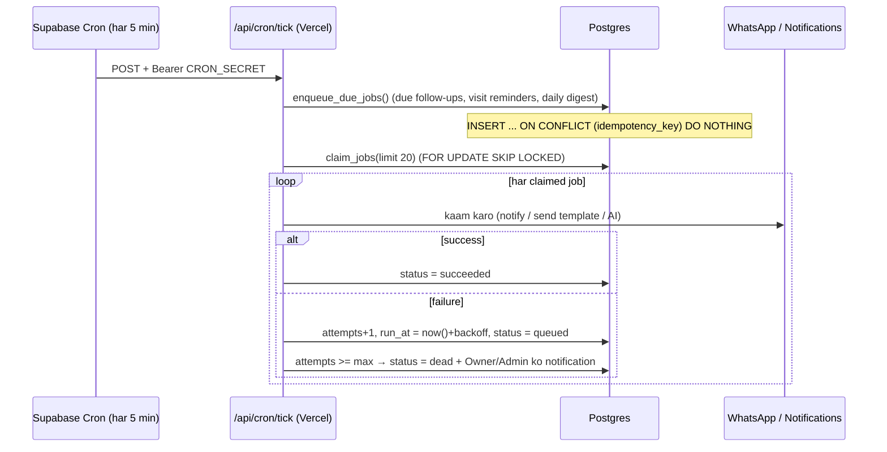

# 05 — WhatsApp Integration, AI Design aur Follow-up Scheduling System

> WhatsApp Cloud API aur AI features **Version 1.1** mein build honge (MVP mein `wa.me` click-to-chat + AI suggestions copy/paste). Jab tak Meta app, test number aur webhook configure aur test nahi hote, inhe "working" nahi maana jaayega.

---

## Part A — WhatsApp Business Platform

### A1. Do levels

| Level | Kaise kaam karta hai | Cost | Kab |
|---|---|---|---|
| **Click-to-chat** | App ek link banata hai: `https://wa.me/919876543210?text=<pre-filled message>`. Agent click karta hai → uske phone/WhatsApp Web mein chat khulti hai → woh khud Send dabata hai. | Free | **MVP** |
| **Cloud API** | Agency ka WhatsApp Business number Meta ke server par. Messages humare server se jaate/aate hain, team inbox mein dikhte hain. | Per-message (doc 02) | **1.1** |

### A2. Setup requirements (Cloud API) — aapko kya karna padega
1. **Meta Business Account** (business.facebook.com) — agency/aapki company ke naam se.
2. **Meta Developer App** (developers.facebook.com) → type *Business* → **WhatsApp** product add karo.
3. Development ke liye Meta ka **test phone number** milta hai + temporary access token; apne kuch phone numbers "recipient" ke roop mein verify karke test kar sakte ho.
4. Production ke liye: real phone number (jo WhatsApp app par active na ho, ya coexistence flow), **display name approval**, **business verification**, payment method, aur **System User permanent access token**.
5. Webhook URL + Verify token configure (neeche).
6. Message templates create → Meta approval.

> Har agency ka apna number = har agency ke liye yeh process. 1.1 mein hum ise **manually onboard** karenge (aap agency ke saath baith ke). Self-serve "Embedded Signup" V2 mein (Meta Tech Provider requirements ke saath).

### A3. Webhook handling — step by step

Endpoint: `/api/webhooks/whatsapp` (Next.js route handler, Node runtime)

**GET (one-time verification):** Meta bhejta hai `hub.mode=subscribe`, `hub.verify_token`, `hub.challenge`. Agar token `WHATSAPP_VERIFY_TOKEN` se match → `hub.challenge` text wapas (200), warna 403.

**POST (har event):**
```
1. Raw body padho (JSON parse se pehle — signature raw bytes par hota hai)
2. X-Hub-Signature-256 = "sha256=" + HMAC_SHA256(raw_body, WHATSAPP_APP_SECRET)?
     ❌ mismatch → 401, log "invalid signature", STOP
3. Har change/message/status se ek event_key banao:
     message → "msg:" + messages[].id
     status  → "status:" + statuses[].id + ":" + statuses[].status
4. INSERT INTO webhook_events (event_key, payload) ON CONFLICT (event_key) DO NOTHING
     → agar row pehle se thi = DUPLICATE (Meta retry) → skip
5. Naye events ke liye job enqueue: type = 'wa.process_event'
6. Turant 200 OK return  (Meta ko jaldi jawab chahiye; slow processing → Meta retry karta hai → duplicates)
```

**Processing job (`wa.process_event`):**
- `metadata.phone_number_id` → `whatsapp_accounts` → **agency_id** (unknown number → event `ignored`, alert).
- **Incoming message:**
  - `from` (wa_id) → E.164 → lead dhoondo `(agency_id, phone_e164)`; nahi mila → naya lead (`source = whatsapp`, `status = new`, unassigned, **opt-in = lead_initiated** consent event).
  - `whatsapp_messages` insert (`wa_message_id` unique → doosra duplicate guard).
  - `leads.last_inbound_at = message timestamp` → **24-hour service window** khulti hai.
  - Opt-out / opt-in keyword check (A5).
  - Assigned agent ko notification; unassigned ho to Owner/Manager ko.
  - (Optional) AI extraction job enqueue — sirf suggestion.
- **Status update** (`sent` → `delivered` → `read` / `failed`): matching outbound message update. Status sirf aage badhega (late `delivered` event `read` ko overwrite nahi karega). `failed` → error code save + agent ko notification.

### A4. Outbound messages — rules jo server enforce karega

```
canSend(lead, kind):
  if lead.opted_out_at is not null           → BLOCK ("Lead ne opt-out kiya hai")
  if kind == 'free_text':
      if now() > lead.last_inbound_at + 24h → BLOCK ("24-hour window band. Template use karo")
  if kind == 'template':
      template.status must be 'APPROVED'
      if template.category == 'marketing' and not lead.whatsapp_opt_in → BLOCK
  if agency quiet hours (21:00–09:00 IST) and message is automated → DEFER to 09:00
  OK
```

Send flow: `whatsapp_messages` row pehle insert (`status = queued`, `idempotency_key`) → Graph API `POST /{phone_number_id}/messages` → response ka `wamid` save, `status = sent`. Network error → job retry (Part C) — same idempotency key ki wajah se do baar row nahi banegi; agar pehli call ka `wamid` already save hai to dobara call nahi.

**Common errors jo handle karenge:** re-engagement / window closed (template chahiye), recipient not on WhatsApp / undeliverable, rate limit / throughput, template paused/rejected, token expired/invalid (Owner ko alert "WhatsApp reconnect karo"). Exact error codes Meta docs se Phase 2 mein map karenge.

### A5. Consent, opt-in aur opt-out

WhatsApp Business Policy: **business-initiated messages ke liye pehle user ka opt-in chahiye**, aur opt-out turant maanna hai.

| Situation | Consent record |
|---|---|
| Lead ne khud WhatsApp kiya | `opt_in`, source `lead_initiated` (auto) |
| Website/landing form par checkbox "WhatsApp par updates chahiye" | `opt_in`, source `web_form`, evidence = form id + timestamp |
| Phone call par haan bola | `opt_in`, source `verbal_on_call`, evidence = agent ka note (weaker evidence — UI mein warning) |
| Lead bheje: `STOP`, `UNSUBSCRIBE`, `OPT OUT`, `BAND KARO`, `MAT BHEJO`, `stop karo` (case-insensitive, exact/near-exact match) | `opt_out`, source `keyword_stop` → `leads.opted_out_at = now()` → saare pending automated jobs us lead ke liye cancel → ek confirmation reply (window ke andar): "Aapko ab messages nahi bheje jayenge. Wapas shuru karne ke liye START bhejein." |
| Lead bheje `START` | `opt_in`, source `keyword_start` → `opted_out_at = null` |
| Agent manually opt-out mark kare | `opt_out`, source `manual` |

`consent_events` **append-only** hai (kabhi edit/delete nahi) — dispute hone par proof.

### A6. Templates (plan)

Templates WhatsApp Manager mein banenge, Meta approve karega; app unhe Graph API se **sync** karega (`whatsapp_templates`) aur sirf `APPROVED` dikhayega. Meta category khud badal bhi sakta hai — sync mein category update hogi.

| Template name | Category | Example body |
|---|---|---|
| `site_visit_confirmation` | Utility | Namaste {{1}}, aapki site visit {{2}} ko {{3}} baje {{4}} par confirm hai. Agent: {{5}}. |
| `site_visit_reminder` | Utility | {{1}}, reminder: aaj {{2}} baje {{3}} par aapki site visit hai. Location: {{4}} |
| `follow_up_check_in` | Marketing (likely) | Namaste {{1}}, {{2}} mein aapki property search kaisi chal rahi hai? Kuch nayi options aayi hain. |
| `new_listing_match` | Marketing | {{1}}, aapke budget mein {{2}} mein naya {{3}} available hai. Details chahiye? |

Har template mein "STOP bhejein messages band karne ke liye" line (marketing ke liye best practice).

---

## Part B — AI design (Claude API)

### B1. AI kya karega — aur kya nahi

| Feature | Input | Output | Human control |
|---|---|---|---|
| **Lead summary** | Lead fields + last ~20 activities/messages | 3–5 line summary | Read-only, `Refresh` button |
| **Qualification** | Same | JSON: `score 0–100`, `temperature_suggestion`, `missing_info[]` (e.g. "timeline nahi pata"), `reasons[]` | Agent "Apply" dabaye tabhi temperature change |
| **Requirement extraction** [1.1] | Incoming WhatsApp text | JSON: budget, locations, BHK, type, purpose | Suggested values; agent approve karta hai |
| **Reply suggestion** | Lead context + conversation + matched properties + agent ka tone choice (Hinglish / English / Hindi) | Draft message | **Hamesha human approve** — edit / approve & send / reject |
| **Daily assistant** [1.1] | Agent ke active leads ka compact data (rule-based pre-ranked top ~30) | Top 10 + har ek ka reason + next action + draft | Suggestions only |

**Kabhi nahi:** AI khud message bhejna, lead delete karna, status badalna, ya kisi doosri agency ka data dekhna. AI ko sirf woh data milta hai jo server ne us user ke RLS-filtered query se nikala.

### B2. Implementation pattern
- Sirf server-side (`lib/ai/*.ts` with `import "server-only"`), official **Anthropic TypeScript SDK** (`@anthropic-ai/sdk`).
- **Structured outputs** (JSON schema) for qualification/extraction → parse + Zod validate → galat JSON par graceful error.
- Prompt mein lead/customer text ko clearly delimit karke "untrusted data" bolna (prompt injection defence).
- Har call `ai_suggestions` mein log: model, tokens, output, status → **actual cost per agency** dikhega.
- **Limits:** per-agency monthly AI call cap (`usage_counters`), per-user rate limit (e.g. 30/min). Limit cross → friendly message.
- Model `AI_MODEL` env se (doc 02 cost table). Timeouts + retries: SDK built-in retries; 429/5xx par user ko "thodi der baad try karo".
- Daily plan **batch** mein raat/subah ek baar banega (cron job), har page load par nahi.

---

## Part C — Follow-up scheduling system

### C1. Do alag concepts

1. **`follow_ups`** = business task ("Rahul ko Friday 11 AM call karo"). Agent dekhta hai, complete karta hai.
2. **`jobs`** = technical kaam jo background mein chalna hai ("11 AM par Rahul ke agent ko notification bhejo", "site visit reminder template bhejo", "daily plan banao").

### C2. Flow



### C3. Duplicate prevention (teen layers)
1. **Idempotency key unique** — e.g. `followup_reminder:{follow_up_id}:{due_at}`, `visit_reminder_24h:{visit_id}`, `daily_plan:{user_id}:{2026-10-24}`. Cron 2 baar chale ya overlap ho — doosri INSERT ignore.
2. **Row locking** — `claim_jobs()` `SELECT … FOR UPDATE SKIP LOCKED` use karta hai: do workers ek hi job nahi utha sakte.
3. **Side-effect markers** — `follow_ups.reminder_sent_at`, `site_visits.reminder_24h_sent_at`, `whatsapp_messages.idempotency_key`. Job retry ho to pehle check: "already bhej diya?" → skip.

Agar follow-up ka time badla (reschedule) → purana pending job `cancelled`, naya key (naya `due_at`) se naya job.

### C4. Retries aur backoff
| Attempt | Kab dobara |
|---|---|
| 1 fail | +1 min |
| 2 fail | +5 min |
| 3 fail | +30 min |
| 4 fail | +2 hr |
| 5 fail | **dead** |

- **Retry karne layak:** network error, timeout, 429, 5xx.
- **Retry nahi (turant dead/skip):** opted-out lead, template rejected, invalid phone, 24-hr window band (free text) — yeh retry se theek nahi honge.
- **Stuck jobs:** `running` status 10 min se zyada → "reaper" wapas `queued` karta hai (worker crash ho gaya tha).
- **Expiry:** site visit nikal gaya aur reminder ab tak nahi gaya → bhejo mat, `skipped (expired)`.

### C5. Failure notifications
- Job `dead` → Owner/Admin ko in-app notification (+ email V2) with reason: "Rahul ko site visit reminder nahi gaya: WhatsApp token expired".
- `/settings` mein **"System health"** chhota panel: last cron run time, queued/failed/dead counts, last 20 failures. **Agar 15 min se cron nahi chala → red warning** (cron hi band ho gaya ho to bhi pata chale).
- Lead-facing messages ke liye **quiet hours** (21:00–09:00 IST) → job `run_at` next 09:00 par shift.

### C6. Scheduled job types
| Job | Trigger | MVP / 1.1 |
|---|---|---|
| `followup.due_notify` | follow-up `due_at` aaya | MVP (in-app) |
| `followup.overdue_scan` | har 5 min; overdue mark + agent ko 1 baar alert | MVP |
| `digest.morning` | 08:30 IST — har agent ko "aaj X follow-ups, Y overdue, Z visits" | MVP (in-app) |
| `visit.reminder_agent` | 24h + 2h pehle | MVP |
| `visit.reminder_lead` | 24h + 2h pehle (utility template, consent check) | 1.1 |
| `wa.process_event` | webhook | 1.1 |
| `wa.sync_templates` | roz 1 baar | 1.1 |
| `ai.daily_plan` | 07:30 IST | 1.1 |
| `maintenance.reaper` | har 5 min | MVP |
